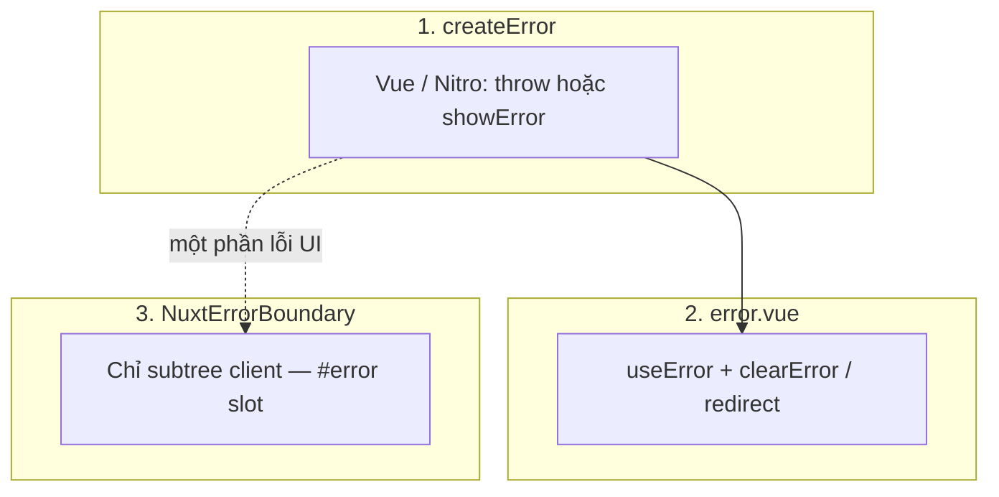

# 📘 Nuxt Error Handling

---

Chương này tập trung vào **ba lớp xử lý lỗi** trong Nuxt:

- (1) **tạo lỗi thống nhất, có kiểu** với `createError`;
- (2) **trang lỗi toàn app** với `error.vue` và composable `useError` / `clearError` để **dẫn user thoát khỏi trạng thái lỗi**;
- (3) **ranh giới lỗi cục bộ** trên client với `NuxtErrorBoundary` để một component hỏng không kéo sập cả app.

Mục tiêu: xử lý lỗi **có chủ đích** ở từng tầng — không trùng vai trò giữa global error page và boundary.

Luồng SSR (middleware, `useAsyncData`, …) xem thêm [Nuxt 3 SSR – Lifecycle](/nuxt-architecture/nuxt-ssr-lifecycle).

---

## 1. `createError` — lỗi thống nhất (Vue + Nitro)

[`createError`](https://nuxt.com/docs/api/utils/create-error) tạo object lỗi Nuxt/H3: **`statusCode`**, **`statusMessage`**, **`fatal`**, và tuỳ chọn **`data`** (payload JSON-safe) để client/server đọc cùng một “hợp đồng” lỗi.

### Trong Vue (page / component)

`throw` trong `setup` / async flow (ví dụ sau `await`) hoặc truyền vào **`showError`** khi muốn đẩy lỗi vào pipeline UI mà không nhất thiết `throw`:

```ts
// Ví dụ: throw — thường dùng khi không thể render page hợp lệ
throw createError({
  statusCode: 404,
  statusMessage: "Not found",
  fatal: true,
});

// Ví dụ: showError — điều khiển hiển thị lỗi từ handler sự kiện
showError(
  createError({
    statusCode: 422,
    statusMessage: "Validation failed",
    data: { fields: ["email"] },
  }),
);
```

Dùng **`data`** cho thông tin có cấu trúc (mã lỗi nội bộ, field lỗi) — tránh nhét chuỗi dài vào `statusMessage` nếu cần i18n / map UI.

### Trong server route (`server/api/*`)

Trong `defineEventHandler`, **`throw createError(...)`** là cách chuẩn để trả **HTTP status** + body lỗi thống nhất với phía client:

```ts
export default defineEventHandler((event) => {
  const id = getRouterParam(event, "id");
  if (!id) {
    throw createError({
      statusCode: 400,
      statusMessage: "Missing id",
      data: { code: "MISSING_ID" },
    });
  }
  return { ok: true };
});
```

Client gọi `$fetch` / `useFetch` nên map `FetchError` / status sang UX (toast, inline, hoặc `showError`).

**Tài liệu:** [`createError`](https://nuxt.com/docs/api/utils/create-error)

---

## 2. Trang lỗi toàn cục — `error.vue`, `useError`, `clearError`

[`error.vue`](https://nuxt.com/docs/guide/directory-structure/error) đặt ở **root** app: đây là **UI lỗi toàn trang** khi Nuxt cần hiển thị error page (fatal, lỗi render không gỡ được, v.v.). Trang này **không** dùng layout page thường — nên self-contained (logo, nút hành động tối thiểu).

**[`useError`](https://nuxt.com/docs/getting-started/error-handling)** (composable) cho phép đọc **lỗi hiện tại** (reactive), thường dùng trong `error.vue` hoặc khi cần hiển thị trạng thái lỗi global.

**[`clearError`](https://nuxt.com/docs/getting-started/error-handling)** xóa lỗi đang active — pattern “recovery”: thử lại, redirect về route an toàn.

```vue
<script setup lang="ts">
import type { NuxtError } from "#app";

defineProps<{ error: NuxtError }>();

function goHome() {
  clearError({ redirect: "/" });
}
</script>

<template>
  <div>
    <h1>{{ error.statusCode }}</h1>
    <p>{{ error.statusMessage }}</p>
    <button type="button" @click="goHome">Về trang chủ</button>
  </div>
</template>
```

Trải nghiệm nhất quán: cùng một **nguồn sự thật** (`createError` + `useError`) cho message/status, và **một lối thoát** rõ (`clearError` / redirect).

**Tài liệu:**

- [Error handling](https://nuxt.com/docs/getting-started/error-handling)
- [`error.vue`](https://nuxt.com/docs/guide/directory-structure/error)
- [`createError`](https://nuxt.com/docs/api/utils/create-error)

---

## 3. Cô lập lỗi phía client — `NuxtErrorBoundary`

[`NuxtErrorBoundary`](https://nuxt.com/docs/api/components/nuxt-error-boundary) bọc **default slot**: lỗi xảy ra trong subtree (client) được bắt bằng `onErrorCaptured` — bạn cung cấp **`#error`** với `{ error, clearError }` để **không** lan lên `error.vue` cho từng vùng UI nhỏ (widget, form nặng, preview).

```vue
<template>
  <NuxtErrorBoundary>
    <RiskyDashboard />
    <template #error="{ error, clearError }">
      <p>Không tải được khối này.</p>
      <button type="button" @click="clearError">Thử lại</button>
    </template>
  </NuxtErrorBoundary>
</template>
```

Có thể lắng nghe **`@error`** để log (Sentry, analytics) mà vẫn để slot `#error` lo UI.

**Phạm vi:** boundary này **xử lý lỗi trong component tree** của slot — không thay cho lỗi **HTTP / SSR toàn page**; với đó vẫn cần `createError` + `error.vue` / xử lý fetch.

**Tài liệu:**

- [`NuxtErrorBoundary`](https://nuxt.com/docs/api/components/nuxt-error-boundary)
- [Error handling](https://nuxt.com/docs/getting-started/error-handling)

---

## So sánh nhanh (ba lớp)

| Lớp                     | Công cụ chính                           | Phạm vi                                   |
| ----------------------- | --------------------------------------- | ----------------------------------------- |
| **Lỗi có cấu trúc**     | `createError` (+ `throw` / `showError`) | Vue + Nitro; status + `data`              |
| **Lỗi toàn app**        | `error.vue`, `useError`, `clearError`   | Trang lỗi global + phục hồi               |
| **Lỗi cục bộ (client)** | `NuxtErrorBoundary`                     | Một vùng UI; slot `#error` + `clearError` |



---

## Ghi chú ngắn (SSR & SEO)

- Lỗi **`fatal`** trong SSR initial có thể ảnh hưởng **HTTP status** trả về — quan trọng cho 404/500 và SEO; chi tiết phụ thuộc hosting / preset.
- **`NuxtErrorBoundary`** là **client**; không dùng thay cho xử lý lỗi server route.

---

## Tài liệu chính thức (tóm gọn)

| Chủ đề                         | Link                                                                                                         |
| ------------------------------ | ------------------------------------------------------------------------------------------------------------ |
| Error handling (tổng quan)     | [nuxt.com/docs/getting-started/error-handling](https://nuxt.com/docs/getting-started/error-handling)         |
| `error.vue` (cấu trúc thư mục) | [nuxt.com/docs/guide/directory-structure/error](https://nuxt.com/docs/guide/directory-structure/error)       |
| `createError`                  | [nuxt.com/docs/api/utils/create-error](https://nuxt.com/docs/api/utils/create-error)                         |
| `NuxtErrorBoundary`            | [nuxt.com/docs/api/components/nuxt-error-boundary](https://nuxt.com/docs/api/components/nuxt-error-boundary) |

---

_End of guide_
